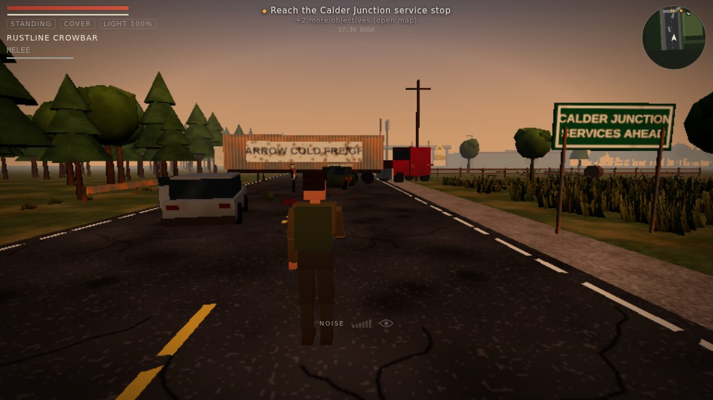
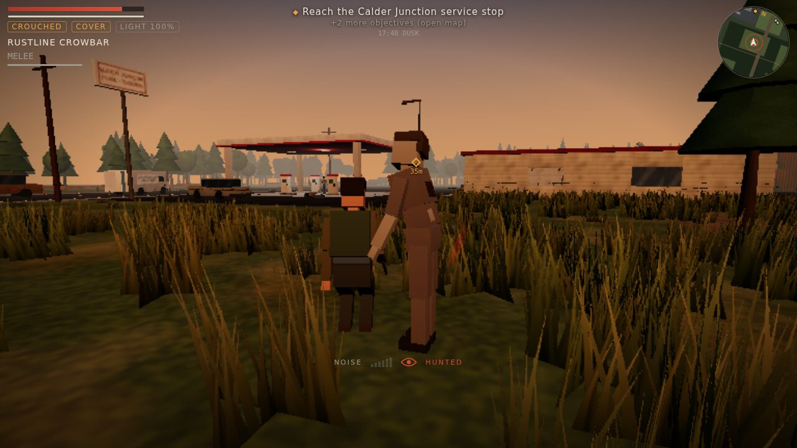
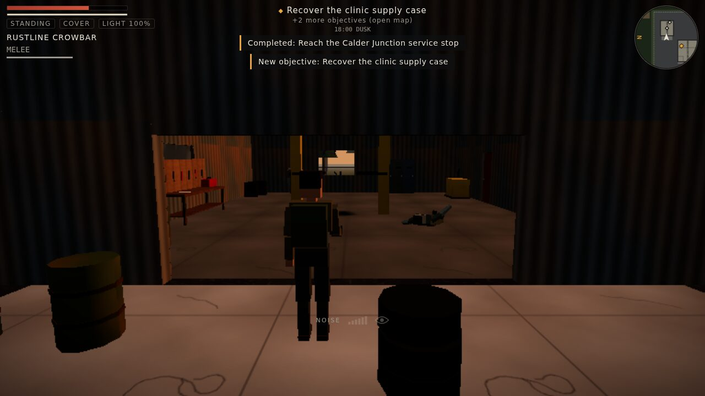
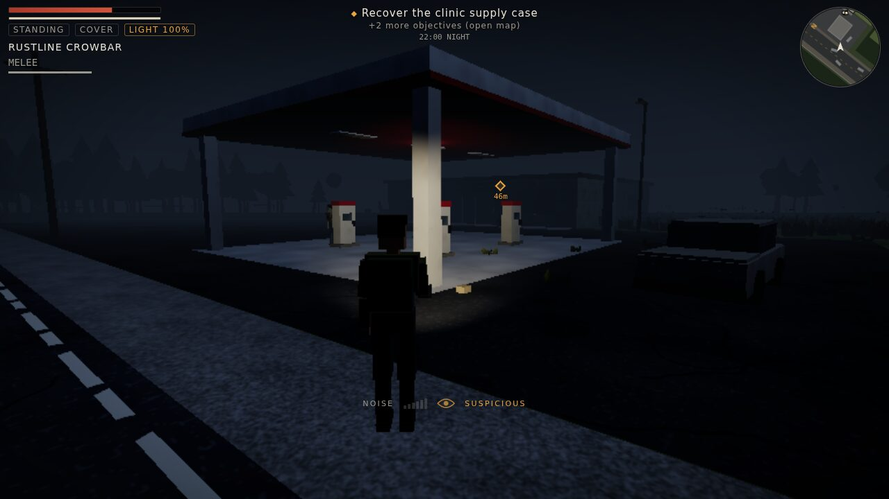
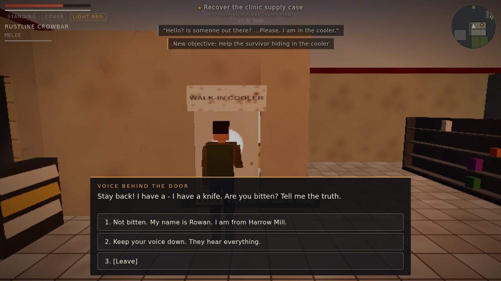
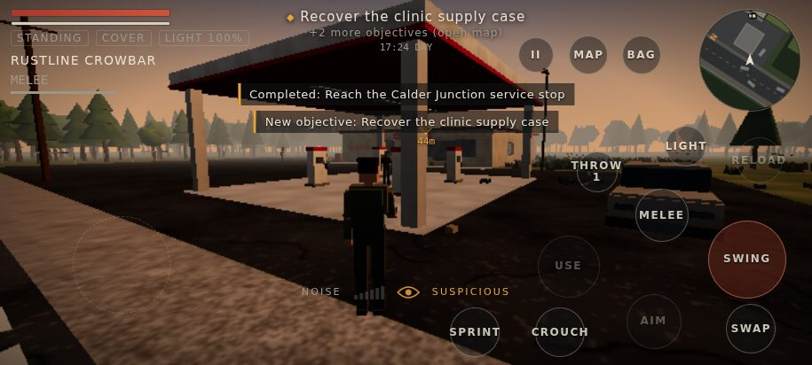

# QUIET COUNTY

**An original third-person survival-action game for Android and iOS. Noise kills.**

Calder Valley went quiet three weeks ago. Most people turned into the Hollow — slow,
blind-ish, and drawn to sound. You are **Rowan Hale**, a former power-line technician
scavenging for the survivors holed up at Harrow Mill. Every footstep, door, swing and
gunshot is information the infected can use against you.



| | |
|---|---|
|  |  |
|  |  |



> Everything you see and hear is original and generated by the game's code at runtime:
> geometry, textures, characters, animation and audio. The repository contains no art,
> audio, names or designs from any existing game or show.

## What is in this build (Phase 1 vertical slice)

A complete, playable mission from start to extraction:

**Mission 01 — "The Silent Road"**: recover a clinic supply case from the abandoned
Calder Junction service stop on Route 9.

- **Primary**: reach the service stop, recover the clinic supply case, meet Teo at the north overpass.
- **Secondary**: find fuel for the mill generator, search the maintenance garage, help Ines (a trucker trapped in the store's walk-in cooler).
- **Optional / hidden**: find Walt's camp through a gap in the back fence.
- **Routes**: a dangerous highway shortcut (loot, wandering infected, a car alarm) or a safe field route through tall grass to a broken window.
- **Scripted beats**: the car alarm and the office siren pull hordes out of the woods.

Systems in the slice:

| Area | Implemented |
|---|---|
| Player | walk / run / sprint / crouch / vault; health, stamina & exhaustion; flashlight with battery; visibility & noise model |
| Combat | crowbar melee (stamina-limited arcs, stagger), compact pistol (hitscan, spread, recoil, aim assist, reload, durability), silent rear takedowns, throwable bottles as distractions |
| Infected AI | idle, wander, investigate sound, detect, chase, attack, lose target, search, return to patrol, stagger, dormant; group alerts; door bashing; vision cones + line of sight; hearing with wall occlusion; flashlight awareness; distance-based simulation LOD |
| World | Calder Junction: highway, fuel canopy, store (shop, office, cooler, storage), garage, farm field, hidden camp, extraction; interiors with auto-hiding roofs; day → night cycle; rain |
| Interaction | search containers (procedural loot), pry / unbar / open doors, pick up, read notes, talk, rest & save, extract |
| NPCs | Ines (dialogue, treatment, follows you, opens doors, mirrors your crouch), Teo (extraction) |
| UI | HUD (vitals, weapon, objective tracker, rotating minimap with your **noise radius ring**, noise meter, detection eye, prompts, world marker, damage direction), inventory, loot, dialogue, notes, map, briefing, pause, results, death, settings, controls editor |
| Mobile | floating joystick, drag-to-look, context buttons, customizable layout/size/opacity/left-handed, haptics, landscape lock, safe areas, dynamic resolution, quality presets |
| Saving | autosave at checkpoints, manual saves at safe radios/camps (refused while hunted), versioned saves with backup slot and migrations, persistent camp profile |

Weapons, infected archetypes, crafting recipes and camp facilities for later phases are
already defined as data (see [docs/GAME_DESIGN.md](docs/GAME_DESIGN.md)).

## Quick start

```bash
cd quiet-county
npm install
npm run dev          # http://localhost:5173  (add ?debug=1 for the QA tools)
```

Desktop controls: **WASD** move (hold Alt to walk) · mouse look (click to capture) ·
**LMB** fire/swing · **RMB** aim · **Shift** sprint · **C** crouch · **E** use (hold) ·
**V** melee/takedown · **R** reload · **Q** swap weapon · **G** throw · **F** flashlight ·
**Tab/I** bag · **M** map · **Esc/P** pause.

Touch controls: drag anywhere on the left for the joystick, drag on the right to look
(FIRE also doubles as a look pad), and use the context buttons. Rearrange them under
*Controls layout*.

## Build for Android and iOS

The game is a web app packaged with [Capacitor](https://capacitorjs.com).

```bash
npm run cap:add        # once: generates android/ and ios/ and applies landscape settings
npm run cap:android    # build, sync and open Android Studio
npm run cap:ios        # build, sync and open Xcode (macOS)
```

Requirements: Android Studio (SDK 24+) for Android; Xcode 16+ on macOS for iOS. The
generated native projects are not committed; `scripts/configure-native.mjs` re-applies
landscape-only orientation and fullscreen after every sync. Saves use Capacitor
Preferences on device (localStorage in the browser).

## Testing

```bash
npm run check        # typecheck + 108 unit tests + production build
npm run test:e2e     # 16 Playwright tests (desktop + mobile), incl. a full mission playthrough
```

The end-to-end suite boots the real game in Chromium. A QA autopilot plays Mission 01
from start to extraction through the same input and UI paths a player uses (walking,
opening and prying doors, dialogue choices, looting, quest pickups, extraction). Other
tests cover combat, stealth, noise, save/load, death and retry, touch controls, the
controls editor, level reachability and render budgets. See
[docs/QA_REPORT.md](docs/QA_REPORT.md).

## Project structure

```
src/
  core/        EventBus, typed GameEvents, Logger, seeded Random, ObjectPool, StateMachine, math
  config/      data only: items, weapons, enemies, loot, player, quality, controls, settings,
               crafting, camp, levels/, missions/, dialogue/
  systems/     engine-independent logic: Inventory, Vitals, WeaponLogic, NoiseSystem, LootSystem,
               MissionSystem, DialogueSystem, SaveSystem, WorldState, TimeOfDay, Weather,
               Crafting, Camp, Conditions, Actions, ai/EnemyBrain
  world/       Physics (OBB colliders + raycasts), NavGrid (A*), LevelBuilder, Zones, WorldObjects,
               prefabs/ (buildings, vehicles, props, fences, vegetation)
  entities/    Player, Infected, EnemyManager (spawning/pooling), Npc, HumanoidRig, Locomotion
  game/        Game (app root, menus, loop), GameSession (per-mission world), CombatSystem,
               InteractionController, SettingsStore
  render/      RenderManager (dynamic resolution), Sky, Effects, Materials, ProceduralTextures,
               StaticBatcher, geometry
  audio/       AudioSystem (procedural WebAudio synthesis, spatialized)
  input/       InputState, TouchControls, KeyboardMouse
  ui/          Hud, MapRenderer, Screens, Overlays, styles
  platform/    Capacitor integration (storage, haptics, orientation)
  debug/       DebugApi (window.__QC), AutoPilot QA bot, LevelValidator
tests/         unit tests (vitest)
e2e/           end-to-end tests (Playwright)
docs/          design, architecture, roadmap and QA documentation
```

More: [Game design](docs/GAME_DESIGN.md) · [Architecture](docs/ARCHITECTURE.md) ·
[Roadmap](docs/ROADMAP.md) · [QA report](docs/QA_REPORT.md)
